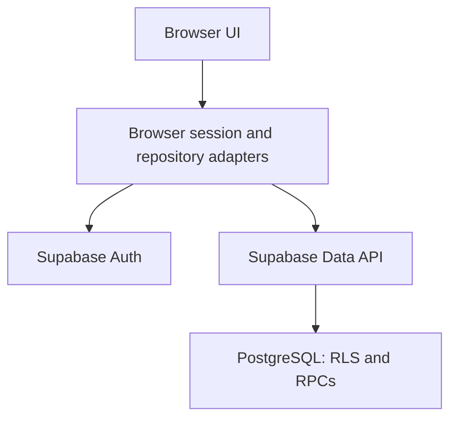

# Backend for Frontend architecture audit

**Finding: the project does not currently implement a separate BFF service.** It is a static browser application using Backend as a Service (BaaS): Supabase Auth and Data API, with PostgreSQL RLS and purpose-shaped RPCs. A JavaScript repository facade that runs in the browser is not a backend boundary.

## Current topology

| Concern | Current implementation | BFF assessment |
|---|---|---|
| Frontend-specific API shape | story-repository.js, public_stories and received_encouragement RPC with count/read state. | Useful response shaping exists; no separately deployed frontend backend. |
| Verified identity | session-restoration.js verifies SDK getUser before UI account state. | Browser verification is UI state; protected writes still rely on database policies. |
| Ownership | stories RLS, auth.uid checks, recipient-only RPCs, pinned search_path. | Keep these if a BFF is later added; a proxy must not bypass ownership. |
| Credential boundary | Public publishable key and SDK-managed browser session; no server secret shipped. | A BFF could keep provider tokens server-side, but that is not the present design. |
| Aggregation | Inbox count/unread and event projection computed in SQL. | Sufficient for the present single browser interface; avoid a redundant network hop. |
| Failure control | Abort-bounded queries, generation guards, private draft/retry UI. | A BFF would also need timeouts, cancellation, trace correlation and idempotency. |
| Cost/operations | Static delivery plus one optional managed project; no custom app server. | Matches the chosen low-cost scope. No performance/availability promise without measurements. 
| Multiple independent clients | One responsive web interface. | No separate mobile/partner interface currently needs a tailored backend. |

Microsoft's BFF guidance describes a backend tailored to an interface and notes that an extra BFF may not suit a single-interface application. That supports retaining the current design; it does not mean direct BaaS and BFF are identical. See [Microsoft's pattern](https://learn.microsoft.com/en-us/azure/architecture/patterns/backends-for-frontends).

## When to reconsider

Consider a BFF when the web UI must combine several services, keep a third-party secret off the browser, or support a separately evolving native client. Decide from measured latency, operational cost and interface needs. Do not add one merely to claim pattern compliance.

A possible future web BFF contract (design suggestion, not implemented):

| Route | Purpose | Required boundary |
|---|---|---|
| GET /api/me | Verified account and own-story summary | Server verification and minimal response. |
| GET /api/me/encouragement?cursor=... | Inbox plus counts | Recipient-only authorization and stable pagination. |
| POST /api/stories/:id/encouragement | Send optional text once | Validated body, owner-derived identity, deduplication, abuse controls. |
| POST /api/me/blocks | Block an event's sender | Derive sender from an owned event; do not trust a supplied recipient. |

A cookie-based implementation would need Secure/HttpOnly/SameSite decisions and CSRF protection; browser bearer tokens and server cookies have different threat boundaries. Preserve RLS and avoid a service-role shortcut. Document observability, error contracts and rollback before deployment. This audit does not create or deploy those routes.
